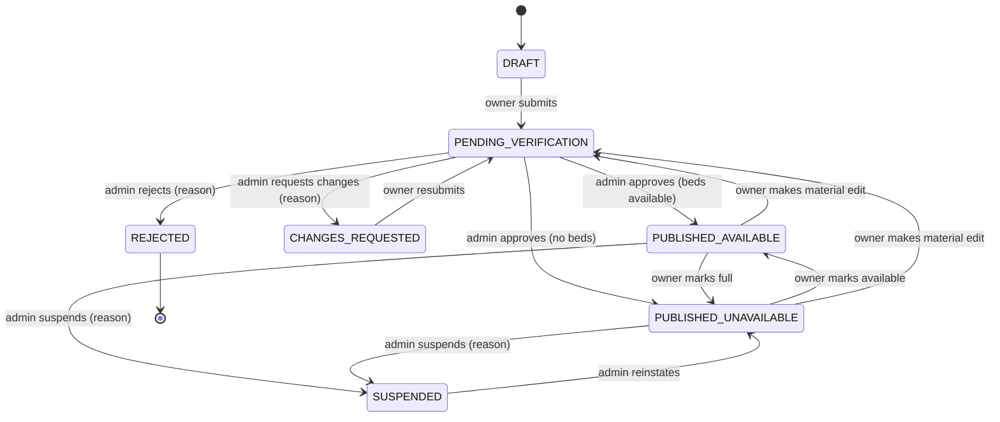

# CampusNest — Scoring Algorithms and Listing Lifecycle

**Status: Proposed.** Values below are documented starting hypotheses. They are kept in one configuration
class so they can be tuned, and any change must be recorded here with its reason.

## 1. Accommodation Suitability Score (FR-1)

### 1.1 Eligibility (hard filters — excluded, not scored)

1. Listing status is `PUBLISHED_AVAILABLE`.
2. Listing gender policy is compatible with the student (ANY, or matches the student's optional gender).
3. At least one room option has `beds_available > 0`.
4. Monthly cost ≤ budget max × **1.30** (30 % stretch tolerance: students often stretch slightly; beyond that
   the option is not realistic).

### 1.2 Components

The score is computed per **room option** (rent differs by room type); a listing's score is its best room
option's score. Each component is 0–100; the total is the weighted sum, rounded to an integer.

| Component | Weight | Rule |
|---|---|---|
| Budget | 30 % | Cost = rent + mandatory recurring monthly charges. Cost ≤ budget max → 100. Above: `100 × (1 − (cost − max) / (0.30 × max))`, reaching 0 at 30 % over. |
| Commute | 25 % | t = estimated minutes, T = student's max. t ≤ T/2 → 100; T/2 < t ≤ T → linear 100 → 70; T < t ≤ 1.5T → linear 70 → 0; beyond → 0. |
| Room type | 15 % | Student ranks acceptable room types. 1st choice 100, 2nd 70, 3rd 40, not ranked 0. |
| Amenities | 15 % | `(2 × must-haves met + nice-to-haves met) / (2 × must-haves + nice-to-haves) × 100`. Unknown = half credit. No amenity preferences → 100. |
| Trust | 15 % | Owner verified 35 + freshness (confirmed ≤ 14 days 30, ≤ 30 days 15, older 0) + rating 25 + no upheld reports in 90 days 10. |

**Rating sub-score:** Bayesian average `(3 × 3.5 + Σratings) / (3 + n)`, mapped to points as
`25 × (avg − 1) / 4`. With no reviews the prior (3.5) applies, so one 5★ review cannot dominate.

**Why these weights:** budget and commute are the two factors the problem statement emphasises and the
hardest to change after moving in (55 % together). Room type, amenities and trust are important but more
negotiable. Validation plan: a short survey of VJTI students ranking the factors; weights updated if results
differ significantly.

### 1.3 Missing data

| Situation | Handling | Shown to student |
|---|---|---|
| Charges not disclosed | Budget uses rent only | "Additional charges not disclosed" |
| No road/transit estimate | Straight-line distance × 1.3 detour factor | "Approximate (straight-line)" |
| Amenity unknown | Half credit | "Wi-Fi: not specified by owner" |
| No reviews | Neutral prior | "No reviews yet" |
| Location missing | Impossible — required before submission | — |

A **data completeness** percentage (known inputs / total inputs) is shown beside the score.

### 1.4 Interpretation

| Score | Label |
|---|---|
| 85–100 | Excellent match |
| 70–84 | Good match |
| 50–69 | Fair match |
| < 50 | Weak match |

Every component returns its score **and** a sentence, e.g. *"₹9,500 rent + ₹800 electricity = ₹10,300,
within your ₹11,000 budget."*

### 1.5 Planned test cases (Phase 5)

Excellent budget match · poor budget match (exactly 30 % over → 0) · excellent commute (t ≤ T/2) · room-type
mismatch · all amenities unknown · unverified owner · availability older than 30 days · ties broken by lower cost.

## 2. Roommate compatibility (FR-2)

### 2.1 Candidates and dealbreakers

Only students with `discoverable = true` and completed core fields, in the same city, are candidates.
A pair is **excluded** (not shown) when:

- either requires a same-gender roommate and genders differ (or either has not provided gender), or
- one marked "cannot live with a smoker" and the other smokes, or
- their budget ranges do not overlap at all.

### 2.2 Weighted factors

| Factor | Weight | Score |
|---|---|---|
| Budget overlap | 20 | overlap width ÷ narrower range width |
| Preferred localities | 15 | shared ÷ union (Jaccard); "anywhere near college" matches all |
| Sleep schedule | 15 | EARLY/REGULAR/LATE: same 100, adjacent 50, opposite 0 |
| Cleanliness (1–5) | 15 | 100 − 25 × difference |
| Smoking (non-dealbreaker) | 10 | both non-smokers 100; outdoor-only smoker with non-smoker 50; both smokers 100 |
| Study environment | 10 | QUIET/MODERATE/LIVELY: same 100, adjacent 50, opposite 0 |
| Guests / social (1–5) | 5 | 100 − 25 × difference |
| Food preference (optional) | 5 | Only when both provided |
| Sharing size | 5 | same preference 100, else 0 |

**Missing optional data:** the factor is skipped and the remaining weights are re-normalised. The result
states "based on N of 9 factors". The score is symmetric (A→B = B→A).

### 2.3 Output

Percentage · list of matching preferences · list of differences/conflicts · one-line summary · disclaimer:
*"This is an estimate based on stated preferences, not a guarantee. Talk before deciding."*

### 2.4 Privacy

Before acceptance a match shows: first name + last initial, course, year, preferences. Contact details
appear only after both accept. Requests are rate-limited; users can block and report.

## 3. Listing lifecycle (FR-3)

**Rules**

- Submit requires: title, map location, ≥ 1 room option with rent, ≥ 1 image, all core amenities declared.
- Reject, request-changes and suspend require a written reason, shown to the owner.
- Material edits (location, photos, property type, description) need re-review. Rent, charges and
  availability updates do not, but are logged.
- Reinstated listings return as `PUBLISHED_UNAVAILABLE`, so the owner must re-confirm availability.
- Stale availability (> 30 days unconfirmed) is a label and trust penalty, not a state.
- If an owner account is suspended, their listings are hidden from search (computed, not a state change).
- All transitions go through one `ListingLifecycleService` with an explicit allowed-transition table;
  anything else returns **409 Conflict**. Each transition writes `listing_status_history`.

**Owner verification** is separate: `UNVERIFIED → PENDING → VERIFIED | REJECTED`; VERIFIED can be revoked.

**Badge wording:** "Owner identity checked by CampusNest" (person) vs. "Listing reviewed by CampusNest"
(listing). Tooltip: *"Reviewed by CampusNest. This is not a guarantee of safety or condition — visit before
paying."*

## 4. Cost-versus-commute (FR-4)

- Compare up to 4 listings: rent, disclosed recurring charges, estimated transport cost, estimated time,
  distance, estimated overall monthly cost.
- **Transport cost** = fare per trip × trips per month (default 2 × 22 college days; student-editable).
  Fares come from `transport_fare_rules`, each with a source and "as of" date entered by an admin from
  official published tables. No fare is hard-coded.
- **Overall monthly cost** is shown only when every part is known; otherwise "Incomplete — <item> not
  disclosed".
- Every estimate carries an "Estimated" label and its source.
- **Modes:** walk and auto/taxi (OSRM road time, or straight-line × 1.3 fallback); local train (owner picks
  the nearest station; admin-maintained station → college time and monthly pass cost; walking time to the
  station computed).
- **Commute estimates are computed once** when a listing is approved (or its location changes) and cached in
  `commute_estimates`. Searches never call an external service.
