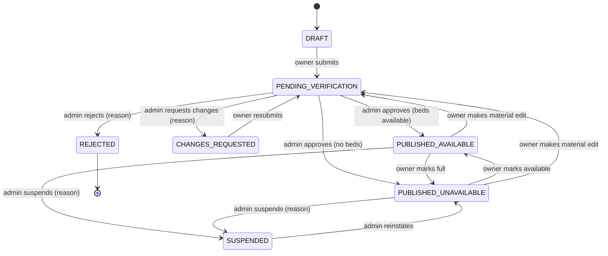

# CampusNest — Scoring Algorithms and Listing Lifecycle

**Status: Proposed.** Values below are documented starting hypotheses. They are kept in one configuration
class so they can be tuned, and any change must be recorded here with its reason.

## 1. Accommodation Suitability Score (FR-1)

**Status: Implemented and tested (Phase 5).** Code: `recommendation/SuitabilityScorer.java` (pure Java, no database),
`RecommendationService.java` (loads real listings and ranks them). Tests: `SuitabilityScorerTest` (19 cases incl. all 7
required by the faculty) and `RecommendationApiTest` (end-to-end, totals checked by hand: 90 and 65).

Implementation notes (differences from the original proposal):
- Preferences store only the **maximum** budget; a minimum budget does not change the score (we never penalise a
  cheaper place), so it was dropped.
- The total is computed from the **rounded** part scores, so anyone can recompute it from the breakdown shown in the UI.
- Gender: listings are excluded only when the student's declared gender conflicts with a women-only / men-only
  policy. If the student has not declared a gender, the listing is shown with a note instead.
- Reviews and reports do not exist until Phase 8, so every listing currently gets the neutral rating prior and
  "no upheld reports".

### 1.1 Eligibility (hard filters — excluded, not scored)

1. Listing status is `PUBLISHED_AVAILABLE`.
2. Listing gender policy is compatible with the student (ANY, or matches the student's optional gender).
3. At least one room option has `beds_available > 0`.
4. Monthly cost ≤ budget max × **1.30** (30 % stretch tolerance: students often stretch slightly; beyond that
   the option is not realistic).

### 1.2 Components

The score is computed per **room option** (rent differs by room type); a listing's score is its best room
option's score. Each component is 0–100; the total is the weighted sum, rounded to an integer.

| Component | Weight | Rule |
|---|---|---|
| Budget | 30 % | Cost = rent + mandatory recurring monthly charges. Cost ≤ budget max → 100. Above: `100 × (1 − (cost − max) / (0.30 × max))`, reaching 0 at 30 % over. |
| Commute | 25 % | t = estimated minutes, T = student's max. t ≤ T/2 → 100; T/2 < t ≤ T → linear 100 → 70; T < t ≤ 1.5T → linear 70 → 0; beyond → 0. |
| Room type | 15 % | Student ranks acceptable room types. 1st choice 100, 2nd 70, 3rd 40, not ranked 0. |
| Amenities | 15 % | `(2 × must-haves met + nice-to-haves met) / (2 × must-haves + nice-to-haves) × 100`. Unknown = half credit. No amenity preferences → 100. |
| Trust | 15 % | Owner verified 35 + freshness (confirmed ≤ 14 days 30, ≤ 30 days 15, older 0) + rating 25 + no upheld reports in 90 days 10. |

**Rating sub-score:** Bayesian average `(3 × 3.5 + Σratings) / (3 + n)`, mapped to points as
`25 × (avg − 1) / 4`. With no reviews the prior (3.5) applies, so one 5★ review cannot dominate.

**Why these weights:** budget and commute are the two factors the problem statement emphasises and the
hardest to change after moving in (55 % together). Room type, amenities and trust are important but more
negotiable. Validation plan: a short survey of VJTI students ranking the factors; weights updated if results
differ significantly.

### 1.3 Missing data

| Situation | Handling | Shown to student |
|---|---|---|
| Charges not disclosed | Budget uses rent only | "Additional charges not disclosed" |
| No road/transit estimate | Straight-line distance × 1.3 detour factor at assumed speeds (below) | "Approximate estimate" |
| Amenity unknown | Half credit | "Wi-Fi: not specified by owner" |
| No reviews | Neutral prior | "No reviews yet" |
| Location missing | Impossible — required before submission | — |

A **data completeness** percentage is shown beside the score: commute (precise = 1, approximate = 0.5) plus one point
for each amenity the student cares about that the owner has answered, divided by the number of items.

**Approximate commute (Phase 5, `commute/ApproximateCommute.java`) — assumptions, to be validated with students:**

| Assumption | Value | Why |
|---|---|---|
| Road distance vs straight line | × 1.3 | Common rule of thumb for dense city street grids |
| Walking speed | 4.5 km/h | Typical planning value for adults |
| Auto-rickshaw average speed | 18 km/h + 5 min to find one | Assumed average including Mumbai traffic; not measured data |
| "Any" mode | walk if road distance ≤ 1.5 km, else auto-rickshaw | Practical choice for short trips |

Local train and bus need station/timetable data and are added in Phase 6; until then a train preference falls back
to the road estimate and the UI says so.

### 1.4 Interpretation

| Score | Label |
|---|---|
| 85–100 | Excellent match |
| 70–84 | Good match |
| 50–69 | Fair match |
| < 50 | Weak match |

Every component returns its score **and** a sentence, e.g. *"₹9,500 rent + ₹800 electricity = ₹10,300,
within your ₹11,000 budget."*

### 1.5 Planned test cases (Phase 5)

Excellent budget match · poor budget match (exactly 30 % over → 0) · excellent commute (t ≤ T/2) · room-type
mismatch · all amenities unknown · unverified owner · availability older than 30 days · ties broken by lower cost.

## 2. Roommate compatibility (FR-2)

**Status: Implemented and tested (Phase 7).** Code: `roommate/CompatibilityScorer.java` (pure Java),
`RoommateService.java`. Tests: `CompatibilityScorerTest` (9, incl. a hand-calculated 45% partial match) and
`RoommateApiTest` (7: privacy, request lifecycle, dealbreakers, blocking, roles).

Implementation details:
- Smoking answers: non-smoker / smokes outdoors only / smoker. "Cannot live with a smoker" excludes both kinds of smoker.
- Same-gender-only is a dealbreaker unless both genders are known and equal (conservative when unknown).
- Food (optional): same or "no preference" 100; two vegetarian-family answers (veg / eggetarian / vegan) 70;
  vegetarian-family vs non-veg 30.
- Areas: chosen from a list of localities near VJTI, or "anywhere near college" (matches everyone).
- Summary bands: ≥ 80 strong, ≥ 60 good, ≥ 40 mixed, otherwise many differences.
- Matches are visible only to students whose own profile is visible (reciprocity). Blocks hide both ways and close
  any open request. Max 10 new requests per day. One pending-or-accepted connection per pair (database index).

### 2.1 Candidates and dealbreakers

Only students with `discoverable = true` and completed core fields, in the same city, are candidates.
A pair is **excluded** (not shown) when:

- either requires a same-gender roommate and genders differ (or either has not provided gender), or
- one marked "cannot live with a smoker" and the other smokes, or
- their budget ranges do not overlap at all.

### 2.2 Weighted factors

| Factor | Weight | Score |
|---|---|---|
| Budget overlap | 20 | overlap width ÷ narrower range width |
| Preferred localities | 15 | shared ÷ union (Jaccard); "anywhere near college" matches all |
| Sleep schedule | 15 | EARLY/REGULAR/LATE: same 100, adjacent 50, opposite 0 |
| Cleanliness (1–5) | 15 | 100 − 25 × difference |
| Smoking (non-dealbreaker) | 10 | both non-smokers 100; outdoor-only smoker with non-smoker 50; both smokers 100 |
| Study environment | 10 | QUIET/MODERATE/LIVELY: same 100, adjacent 50, opposite 0 |
| Guests / social (1–5) | 5 | 100 − 25 × difference |
| Food preference (optional) | 5 | Only when both provided |
| Sharing size | 5 | same preference 100, else 0 |

**Missing optional data:** the factor is skipped and the remaining weights are re-normalised. The result
states "based on N of 9 factors". The score is symmetric (A→B = B→A).

### 2.3 Output

Percentage · list of matching preferences · list of differences/conflicts · one-line summary · disclaimer:
*"This is an estimate based on stated preferences, not a guarantee. Talk before deciding."*

### 2.4 Privacy

Before acceptance a match shows: first name + last initial, course, year, preferences. Contact details
appear only after both accept. Requests are rate-limited; users can block and report.

## 3. Listing lifecycle (FR-3)

**Status: Implemented and tested (Phase 3)** — `ListingLifecycle.java` (table), `ListingLifecycleService.java`
(the only code that changes a status), `ListingLifecycleTest` + `ListingWorkflowTest`.

**Rules**

- Submit requires (`SubmissionChecklist.java`): description ≥ 30 characters, street address and locality, 6-digit PIN
  code, a map location inside the Mumbai region, ≥ 1 room type with rent, ≥ 1 photo, and a yes/no answer for all
  8 core amenities. Missing items are returned as a list so the owner sees exactly what to fix.
- While a listing is under review the owner cannot edit it (409 `LISTING_UNDER_REVIEW`).
- Reject, request-changes and suspend require a written reason, shown to the owner.
- Material edits (title, description, address, location, property type, gender policy, amenities, photos) need
  re-review. Rent, charges and bed counts do not (owners must be able to keep prices and availability current).
- Reinstated listings return as `PUBLISHED_UNAVAILABLE`, so the owner must re-confirm availability.
- Stale availability (> 30 days unconfirmed) is a label and trust penalty, not a state.
- If an owner account is suspended, their listings are hidden from search (computed, not a state change).
- All transitions go through one `ListingLifecycleService` with an explicit allowed-transition table;
  anything else returns **409 Conflict**. Each transition writes `listing_status_history`.

**Owner verification** is separate: `UNVERIFIED → PENDING → VERIFIED | REJECTED`; VERIFIED can be revoked.

**Badge wording:** "Owner identity checked by CampusNest" (person) vs. "Listing reviewed by CampusNest"
(listing). Tooltip: *"Reviewed by CampusNest. This is not a guarantee of safety or condition — visit before
paying."*

## 4. Cost-versus-commute (FR-4)

**Status: Implemented and tested (Phase 6).** Code: `commute/CommuteService.java`, `CommuteModel.java`,
`FareCalculator.java`, `recommendation/ComparisonService.java`. Tests: `FareCalculatorTest`, `CommuteModelTest`,
`ComparisonApiTest`.

### 4.1 What is implemented

| Mode | Time estimate (assumption) | Monthly cost estimate | Source of cost |
|---|---|---|---|
| Walk | road km (straight × 1.3) at 4.5 km/h | ₹0 | — |
| Auto-rickshaw | road km at 18 km/h + 5 min waiting | (₹27 for first 1.5 km + ₹18.22/km) × 2 trips × college days | MMRTA tariff effective 1 Sep 2026 (reported by Time Out Mumbai citing Mid-Day) |
| BEST bus (non-AC) | road km at 13 km/h + 10 min waiting; **assumes a direct route exists** | slab fare (₹10 ≤ 5 km, ₹15 ≤ 10, ₹20 ≤ 15, ₹30 ≤ 20, ₹35 ≤ 25) × trips | BEST revision of 9 May 2025 (Free Press Journal) |
| Local train | walk to nearest station + 8 min wait + rail (straight line between stations × 1.2 at 30 km/h) + walk from the station nearest the college. Not offered if same station, rail < 2 km, or walk to station > 25 min | monthly pass from admin-entered fare slabs | **None entered**: no current official table could be verified on 2026-11-01, so pass cost shows "not available" |

- Stations: 59 Mumbai suburban stations from OpenStreetMap (© OpenStreetMap contributors, ODbL), extracted
  2026-11-01. Line labels in OSM are not reliable, so the model ignores lines (no transfer logic) — a known
  simplification.
- Fare rules live in `fare_rules`, each with source and "applies from" date; admins add/remove them at
  `/admin/fares`. CampusNest never invents a fare: no rule → "not available".
- **Suggested mode** for the overall total: among available modes within the student's commute limit, the cheapest
  with a known cost (ties → faster); if none is within the limit, the fastest. The student can switch the mode.
- **Overall monthly cost** = rent of the compared room + compulsory monthly charges + travel cost of the chosen mode,
  shown only when all parts are known; otherwise "Incomplete — <reason>".
- The suitability score's commute part now uses the same estimates: the student's chosen mode if available, else
  the fastest practical option (walking only if ≤ 30 min; bus never auto-picked because routes are unknown).

- Compare up to 4 listings: rent, disclosed recurring charges, estimated transport cost, estimated time,
  distance, estimated overall monthly cost.
- **Transport cost** = fare per trip × trips per month (default 2 × 22 college days; student-editable).
  Fares come from `transport_fare_rules`, each with a source and "as of" date entered by an admin from
  official published tables. No fare is hard-coded.
- **Overall monthly cost** is shown only when every part is known; otherwise "Incomplete — <item> not
  disclosed".
- Every estimate carries an "Estimated" label and its source.
- **Modes:** walk and auto/taxi (OSRM road time, or straight-line × 1.3 fallback); local train (owner picks
  the nearest station; admin-maintained station → college time and monthly pass cost; walking time to the
  station computed).
- **Commute estimates are computed once** when a listing is approved (or its location changes) and cached in
  `commute_estimates`. Searches never call an external service.
