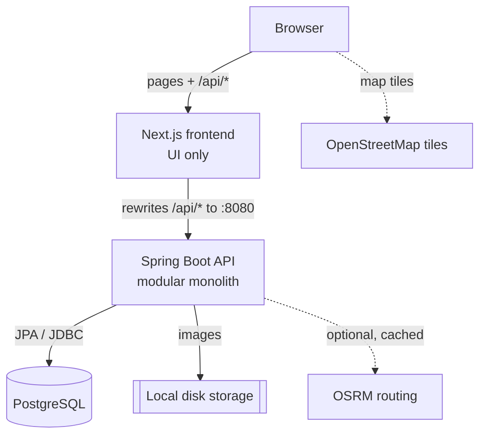

# CampusNest — Architecture

## 1. Style: modular monolith

One Spring Boot application, one PostgreSQL database, one Next.js frontend. Inside the backend, code is
grouped by **feature module** (not by technical layer), so each team member owns a vertical slice.



Why not microservices: three students, one semester, one database. A monolith is easier to run, debug, test
and explain, and well-separated modules can still be split later if CampusNest ever needs it.

## 2. Responsibilities

| Layer | Owns | Never does |
|---|---|---|
| Frontend (Next.js) | Rendering, navigation, forms, client-side validation for convenience, maps display, calling the API | Deciding permissions, computing scores, trusting its own role checks |
| Backend (Spring Boot) | Business rules, scoring, listing state machine, authentication, authorization (role + ownership), validation, privacy filtering, file handling | Rendering HTML |
| Database (PostgreSQL) | Durable data, integrity (FK, unique, check constraints), indexes, audit history | Business logic in triggers/stored procedures (kept in Java so it is testable) |

## 3. Backend package structure

```
com.campusnest
├── common/          shared: security config & filters, error handling, health  (Phase 1–2 ✔)
├── auth/            user accounts, registration, current user, admin seeding   (Phase 2 ✔)
├── college/         college reference data                                     (Phase 2 ✔)
├── student/         student profile ✔, preferences                             (Phase 2/4)
├── owner/           owner profile ✔                                            (Phase 2)
├── listing/         listings, rooms, charges, amenities, photos, state machine ✔ (Phase 3)
├── moderation/      admin user management ✔, listing review ✔, verification, reports (Phase 2/3/8)
├── discovery/       search, saved listings, enquiries, reviews               (Phase 4/8)
├── recommendation/  suitability scoring and ranking ✔                         (Phase 5)
├── commute/         approximate commute ✔; stations, fares, comparison        (Phase 5/6)
├── engagement/      saved listings ✔, enquiries ✔; reviews, reports           (Phase 4/8)
└── roommate/        roommate profiles, compatibility, requests, blocks ✔      (Phase 7)
```

Inside each module: `controller` (HTTP) → `service` (rules, authorization checks) → `repository`
(database), with `dto` records for request/response bodies. Entities are never returned directly from
controllers, so private fields cannot leak by accident.

## 4. Key technology decisions

| Decision | Choice | Reason |
|---|---|---|
| Java version | 25 LTS | Long-term support; supported by Spring Boot 4.1 |
| Build tool | Maven Wrapper | Nothing to install; same Maven version for all teammates |
| Schema management | Flyway SQL migrations | Every change versioned in Git; plain SQL is easy to explain |
| Hibernate DDL | `validate` only | Hibernate never silently changes tables |
| Auth (D1) | Server-side session + HttpOnly cookie | JavaScript cannot read the cookie (XSS cannot steal it); logout really ends the session |
| Frontend → backend | Next.js rewrites `/api/*` | Same origin for the browser → cookies work, CORS not needed in normal use |
| Database runtime (D3) | PostgreSQL 18 in Docker | Identical setup for all teammates; apps still run natively |
| Integration tests | Testcontainers | Tests use real PostgreSQL, not an in-memory imitation |
| Styling (D8) | Tailwind CSS 4 + own tokens | Free, fast, no generic component kit look |
| Maps | Leaflet + OpenStreetMap | Free and open; attribution required |
| Routing | OSRM, optional and cached | Free; public server is demo-only, so never on the request path |
| Geo maths | Haversine in Java (no PostGIS) | Sufficient at city scale, nothing extra to install |

## 5. Security design

| Concern | Approach | Phase |
|---|---|---|
| Default policy | Deny by default: all endpoints need authentication unless listed public in `SecurityConfig` | 1 ✔ |
| Error leakage | `server.error.include-stacktrace=never`, `include-message=never` | 1 ✔ |
| Security headers | Spring Security defaults (`X-Frame-Options: DENY`, `nosniff`, no-cache) | 1 ✔ |
| Secrets | `.env` git-ignored; `.env.example` placeholders only; DB bound to 127.0.0.1 | 1 ✔ |
| CORS | Allow-list from `FRONTEND_ORIGIN`, credentials allowed, `/api/**` only | 1 ✔ |
| Passwords | BCrypt via `DelegatingPasswordEncoder` | 2 |
| Sessions | HttpOnly, SameSite=Lax, Secure in production; session fixation protection | 2 |
| CSRF | Enabled; token in readable `XSRF-TOKEN` cookie, sent back in `X-XSRF-TOKEN` header | 2 |
| Authorization | URL role rules + service-level ownership checks (prevents IDOR) | 2–3 |
| Validation | Jakarta Bean Validation on all request DTOs; global JSON error handler | 2 |
| Rate limiting | Login, registration, enquiries, roommate requests (Bucket4j) | 2/7 |
| Uploads | JPEG/PNG allow-list by magic bytes (WebP dropped: Java's built-in image library cannot re-encode it), ≤ 5 MB, ≤ 6000 px checked before decoding, decoded and re-encoded (EXIF/GPS removed), random UUID names, stored outside the web root, served only through an access-checked endpoint | 3 ✔ |
| Concurrent edits | `@Version` optimistic locking on listings → 409 instead of silently overwriting | 3 ✔ |
| Injection / XSS | JPA parameterised queries only; React escaping; no `dangerouslySetInnerHTML` | all |

## 6. API design (proposed, all under `/api/v1`)

URL rule: each role has its own area — `/student/**` (STUDENT), `/owner/**` (OWNER), `/admin/**` (ADMIN) —
enforced in `SecurityConfig`. Inside an area, services additionally check that a record belongs to the caller.
✔ = implemented and tested.

| Group | Endpoints | Role |
|---|---|---|
| Health | `GET /health` ✔ | public |
| Auth | `POST /auth/register` (JSON) ✔, `POST /auth/login` (form: `email`, `password`) ✔, `POST /auth/logout` ✔, `GET /auth/me` ✔, `GET /auth/csrf` ✔ | public / any logged-in |
| Account | `PUT /users/me` (name, phone) ✔ | any logged-in |
| Colleges | `GET /colleges` ✔ | public |
| Student | `GET/PUT /student/profile` ✔, `GET/PUT /student/preferences` ✔ (GET = 204 if not set), `GET /student/recommendations` ✔ (409 `COLLEGE_REQUIRED` / `PREFERENCES_REQUIRED`), `GET /student/recommendations/listings/{id}` ✔ (breakdown or exclusion reasons), `GET /student/compare?ids=1,2,3&daysPerMonth=22` ✔ (2–4 listings) | STUDENT |
| Fare rules | `GET /fare-rules` ✔ (public, with sources), `POST /admin/fare-rules` ✔ (source + date required), `DELETE /admin/fare-rules/{id}` ✔ | public / ADMIN |
| Discovery | `GET /listings?q=&maxRent=&roomType=&suitableFor=&amenities=&availableOnly=&collegeId=&maxDistanceKm=&sort=&page=` ✔, `GET /listings/{id}` ✔ (published only, no owner contact) | public |
| Saved | `GET /student/saved` ✔, `PUT/DELETE /student/saved/{listingId}` ✔ (idempotent) | STUDENT |
| Enquiries | `POST /student/enquiries` ✔ (start or continue; optional `shareContact`), `GET /student/enquiries` ✔, `GET /owner/enquiries` ✔, `GET /enquiries/{id}` ✔, `POST /enquiries/{id}/messages` ✔ | participants only |
| Amenities | `GET /amenities` ✔ | public |
| Listing photos | `GET /listing-images/{id}` ✔ (public only if the listing is published; owner always; admin except drafts) | public / checked per photo |
| Owner | `GET/PUT /owner/profile` ✔, `GET/POST /owner/listings` ✔, `GET/PUT/DELETE /owner/listings/{id}` ✔ (delete = drafts only), `POST /owner/listings/{id}/submit` ✔, `PATCH /owner/listings/{id}/availability` ✔, `POST /owner/listings/{id}/images` ✔ (multipart `file`), `DELETE /owner/listings/{id}/images/{imageId}` ✔ | OWNER (own only) |
| Admin | `GET /admin/users?role=&page=` ✔, `POST /admin/users/{id}/suspend` ✔ (reason required), `POST /admin/users/{id}/reinstate` ✔, `GET /admin/listings?status=&page=` ✔, `GET /admin/listings/{id}` ✔, `POST /admin/listings/{id}/approve` ✔, `…/request-changes` ✔, `…/reject` ✔, `…/suspend` ✔ (reason required for these three), `…/reinstate` ✔, `POST /admin/owners/{id}/verification`, `GET/POST /admin/reports…` | ADMIN |
| Reviews & reports | `GET /listings/{id}/reviews`, `POST /student/reviews`, `POST /reports` | STUDENT / OWNER |
| Roommates | `GET/PUT /student/roommates/profile` ✔ (GET = 204 if none), `GET /student/roommates/matches` ✔ (409 `ROOMMATE_PROFILE_REQUIRED`), `GET/POST /student/roommates/requests` ✔, `POST /student/roommates/requests/{id}/accept\|decline\|withdraw` ✔, `GET /student/roommates/connections` ✔ (only place with full name + contact), `POST /student/roommates/blocks/{userId}` ✔ | STUDENT |

Conventions: JSON bodies; errors as `{ "error": "CODE", "message": "...", "fields": {...} }`; 400 validation,
401 not logged in (or account suspended), 403 wrong role / missing CSRF token, 404 not found (also used when a
record exists but the caller may not know it exists), 409 conflict / invalid state transition, 429 too many
login attempts.

### How login works (for the viva)

1. The frontend calls `GET /auth/csrf`; Spring sets a readable `XSRF-TOKEN` cookie.
2. The login form posts `email` + `password` with header `X-XSRF-TOKEN: <cookie value>`.
3. `LoginRateLimitFilter` refuses the attempt if that email has 5 recent failures.
4. Spring Security's `UsernamePasswordAuthenticationFilter` loads the account (`AppUserDetailsService`) and
   checks the password against the BCrypt hash. Suspended accounts are rejected as "disabled".
5. On success Spring creates a **new** session id (prevents session fixation), stores the user in it, rotates
   the CSRF token, and `JsonAuthenticationHandlers` returns the user as JSON. The browser only holds the
   HttpOnly `JSESSIONID` cookie.
6. On every later request, `ActiveAccountFilter` re-checks that the account is still active, then the URL role
   rules decide 200 / 401 / 403.

## 7. External services and their limits

| Service | Use | Constraint (to re-verify against current policy before Phase 6) | Fallback |
|---|---|---|---|
| OpenStreetMap tiles | Map display | Attribution required; low-volume use only; no bulk downloading | Map hidden; text address still shown |
| OSRM public demo server | Road/walk time | **Not used** in v1: estimates use straight-line × 1.3 so the app never depends on it | — |
| OpenStreetMap Overpass API | One-off extract of 59 suburban stations (2026-11-01), stored in migration V5 | Light use only; data ODbL (attribution shown on the comparison page) | Data is stored locally; no runtime calls |
| Nominatim | (Optional) address search | ~1 request/s, identifying User-Agent, no autocomplete | Owner drops a pin on the map instead |

No service requires payment, an API key or a credit card. The application runs fully without any of them.
