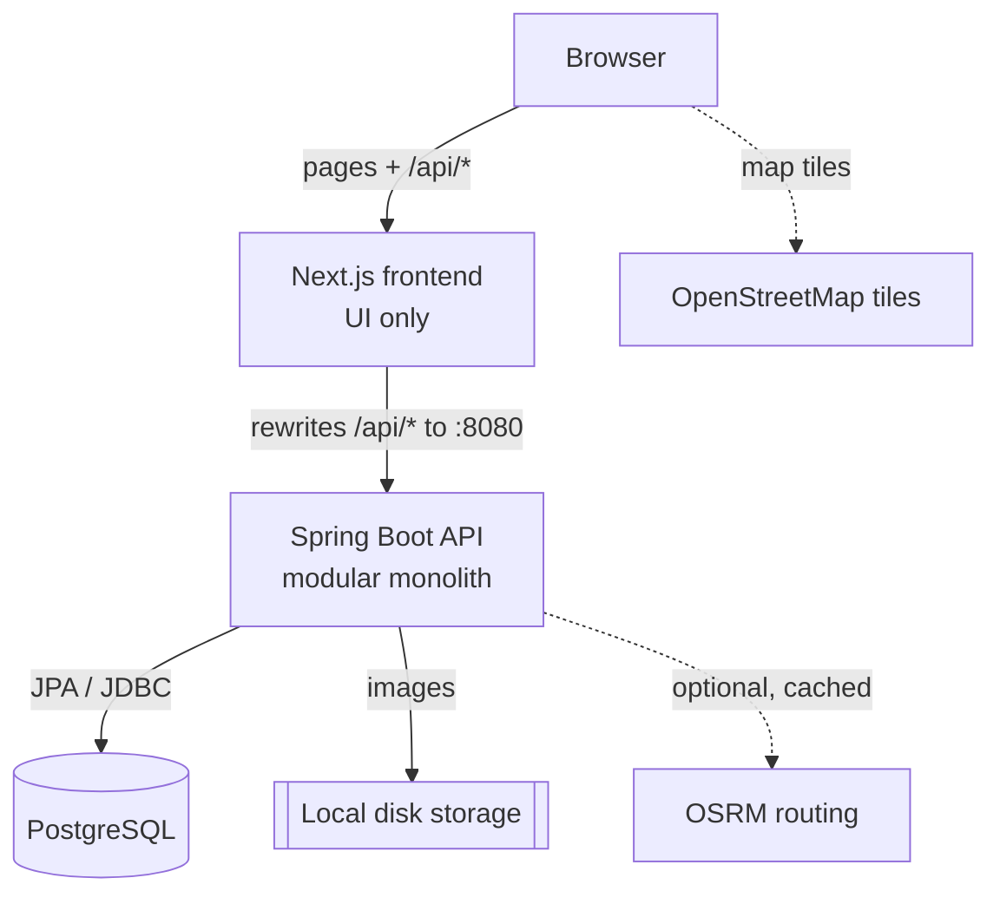

# CampusNest — Architecture

## 1. Style: modular monolith

One Spring Boot application, one PostgreSQL database, one Next.js frontend. Inside the backend, code is
grouped by **feature module** (not by technical layer), so each team member owns a vertical slice.



Why not microservices: three students, one semester, one database. A monolith is easier to run, debug, test
and explain, and well-separated modules can still be split later if CampusNest ever needs it.

## 2. Responsibilities

| Layer | Owns | Never does |
|---|---|---|
| Frontend (Next.js) | Rendering, navigation, forms, client-side validation for convenience, maps display, calling the API | Deciding permissions, computing scores, trusting its own role checks |
| Backend (Spring Boot) | Business rules, scoring, listing state machine, authentication, authorization (role + ownership), validation, privacy filtering, file handling | Rendering HTML |
| Database (PostgreSQL) | Durable data, integrity (FK, unique, check constraints), indexes, audit history | Business logic in triggers/stored procedures (kept in Java so it is testable) |

## 3. Backend package structure

```
com.campusnest
├── common/          shared: security config, error handling, storage, health
├── auth/            users, registration, login/logout, current user          (Phase 2)
├── student/         student profile, preferences                             (Phase 2/4)
├── listing/         listings, rooms, charges, amenities, images, lifecycle   (Phase 3)
├── moderation/      admin review, owner verification, reports, audit         (Phase 3/8)
├── discovery/       search, saved listings, enquiries, reviews               (Phase 4/8)
├── recommendation/  suitability scoring                                       (Phase 5)
├── commute/         distance, routing, fares, comparison                      (Phase 6)
└── roommate/        roommate profiles, compatibility, requests                (Phase 7)
```

Inside each module: `controller` (HTTP) → `service` (rules, authorization checks) → `repository`
(database), with `dto` records for request/response bodies. Entities are never returned directly from
controllers, so private fields cannot leak by accident.

## 4. Key technology decisions

| Decision | Choice | Reason |
|---|---|---|
| Java version | 25 LTS | Long-term support; supported by Spring Boot 4.1 |
| Build tool | Maven Wrapper | Nothing to install; same Maven version for all teammates |
| Schema management | Flyway SQL migrations | Every change versioned in Git; plain SQL is easy to explain |
| Hibernate DDL | `validate` only | Hibernate never silently changes tables |
| Auth (D1) | Server-side session + HttpOnly cookie | JavaScript cannot read the cookie (XSS cannot steal it); logout really ends the session |
| Frontend → backend | Next.js rewrites `/api/*` | Same origin for the browser → cookies work, CORS not needed in normal use |
| Database runtime (D3) | PostgreSQL 18 in Docker | Identical setup for all teammates; apps still run natively |
| Integration tests | Testcontainers | Tests use real PostgreSQL, not an in-memory imitation |
| Styling (D8) | Tailwind CSS 4 + own tokens | Free, fast, no generic component kit look |
| Maps | Leaflet + OpenStreetMap | Free and open; attribution required |
| Routing | OSRM, optional and cached | Free; public server is demo-only, so never on the request path |
| Geo maths | Haversine in Java (no PostGIS) | Sufficient at city scale, nothing extra to install |

## 5. Security design

| Concern | Approach | Phase |
|---|---|---|
| Default policy | Deny by default: all endpoints need authentication unless listed public in `SecurityConfig` | 1 ✔ |
| Error leakage | `server.error.include-stacktrace=never`, `include-message=never` | 1 ✔ |
| Security headers | Spring Security defaults (`X-Frame-Options: DENY`, `nosniff`, no-cache) | 1 ✔ |
| Secrets | `.env` git-ignored; `.env.example` placeholders only; DB bound to 127.0.0.1 | 1 ✔ |
| CORS | Allow-list from `FRONTEND_ORIGIN`, credentials allowed, `/api/**` only | 1 ✔ |
| Passwords | BCrypt via `DelegatingPasswordEncoder` | 2 |
| Sessions | HttpOnly, SameSite=Lax, Secure in production; session fixation protection | 2 |
| CSRF | Enabled; token in readable `XSRF-TOKEN` cookie, sent back in `X-XSRF-TOKEN` header | 2 |
| Authorization | URL role rules + service-level ownership checks (prevents IDOR) | 2–3 |
| Validation | Jakarta Bean Validation on all request DTOs; global JSON error handler | 2 |
| Rate limiting | Login, registration, enquiries, roommate requests (Bucket4j) | 2/7 |
| Uploads | JPEG/PNG/WebP allow-list by magic bytes, ≤ 5 MB, random names, outside web root, EXIF stripped | 3 |
| Injection / XSS | JPA parameterised queries only; React escaping; no `dangerouslySetInnerHTML` | all |

## 6. API design (proposed, all under `/api/v1`)

| Group | Endpoints | Role |
|---|---|---|
| Health | `GET /health` | public ✔ |
| Auth | `POST /auth/register`, `POST /auth/login`, `POST /auth/logout`, `GET /auth/me` | public / any |
| Student | `GET/PUT /students/me/profile`, `GET/PUT /students/me/preferences` | STUDENT |
| Discovery | `GET /listings?…filters`, `GET /listings/{id}`, `GET /recommendations`, `GET /compare?ids=` | public / STUDENT |
| Owner | `GET/POST /owner/listings`, `GET/PUT/DELETE /owner/listings/{id}`, `POST /owner/listings/{id}/submit`, `PATCH /owner/listings/{id}/availability`, `POST /owner/listings/{id}/images` | OWNER (own only) |
| Admin | `GET /admin/listings?status=`, `POST /admin/listings/{id}/approve\|reject\|request-changes\|suspend\|reinstate`, `POST /admin/owners/{id}/verification`, `GET/POST /admin/reports…`, `POST /admin/users/{id}/suspend\|reinstate` | ADMIN |
| Engagement | `GET/POST/DELETE /saved`, `GET/POST /enquiries`, `POST /enquiries/{id}/messages`, `GET/POST /listings/{id}/reviews`, `POST /reports` | STUDENT / OWNER |
| Roommates | `GET/PUT /roommates/me`, `GET /roommates/matches`, `POST /roommates/requests`, `PATCH /roommates/requests/{id}` | STUDENT |

Conventions: JSON bodies; errors as `{ "error": "CODE", "message": "...", "fields": {...} }`; 400 validation,
401 not logged in, 403 wrong role/not owner, 404 not found (also used when a record exists but the caller may
not know it exists), 409 invalid state transition.

## 7. External services and their limits

| Service | Use | Constraint (to re-verify against current policy before Phase 6) | Fallback |
|---|---|---|---|
| OpenStreetMap tiles | Map display | Attribution required; low-volume use only; no bulk downloading | Map hidden; text address still shown |
| OSRM public demo server | Road/walk time | Demo use only, rate-limited, no uptime guarantee | Straight-line × detour factor, labelled "approximate" |
| Nominatim | (Optional) address search | ~1 request/s, identifying User-Agent, no autocomplete | Owner drops a pin on the map instead |

No service requires payment, an API key or a credit card. The application runs fully without any of them.
