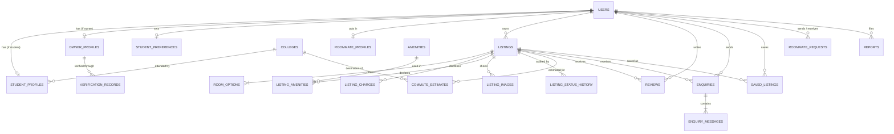

# CampusNest — Database Design

Tables are created phase by phase through Flyway migrations in
`backend/src/main/resources/db/migration` (`V1__…sql`, `V2__…sql`, …). This document is updated whenever a
migration is added. **Never edit an applied migration — add a new one.**

| Migration | Tables | Status |
|---|---|---|
| `V1__accounts_colleges_profiles.sql` (Phase 2) | `colleges` (VJTI seeded from OpenStreetMap coordinates), `users`, `student_profiles`, `owner_profiles` | Implemented & tested |
| `V2__listings.sql` (Phase 3) | `amenities` (15 seeded, 8 core), `listings`, `room_options`, `listing_charges`, `listing_amenities`, `listing_images`, `listing_status_history` | Implemented & tested |
| `V3__saved_listings_and_enquiries.sql` (Phase 4) | `saved_listings`, `enquiries` (with `student_shares_contact` / `owner_shares_contact`), `enquiry_messages` | Implemented & tested |
| Phase 5+ | all other tables below | Proposed |

Phase 3 differences from the proposal:
- Money and counts are `INTEGER` (whole rupees), not decimals.
- `listings` also has `status_reason` (latest admin message), `submitted_at` and `version` (optimistic locking).
- `listing_charges` uses `mandatory` (must every tenant pay?) instead of `included_in_rent`.
- `listing_amenities` has a surrogate `id` plus a unique (listing, amenity) constraint, which is simpler to map in JPA
  than a composite key.
- `listings.nearest_station_id` and the `stations` table are deferred to Phase 6 (commute).

Implemented differences from the proposal: `users` also has `status_reason` (why an admin suspended the
account); emails are enforced lower-case by a CHECK constraint, so a plain UNIQUE constraint prevents
case-variant duplicates.

## 1. Entity relationship diagram

`transport_fare_rules` and `stations` are standalone reference tables (no relationships shown).

## 2. Tables

| Table | Key columns | Constraints & notes |
|---|---|---|
| `users` | id PK, email, password_hash, role, status, display_name, phone, created_at, last_login_at | unique `lower(email)`; role ∈ STUDENT/OWNER/ADMIN; status ∈ ACTIVE/SUSPENDED |
| `colleges` | id PK, name, short_name, address, city, lat, lng | unique (short_name, city). VJTI seeded |
| `student_profiles` | user_id PK/FK, college_id FK, course, year_of_study, gender (optional) | 1:1 with users |
| `student_preferences` | user_id PK/FK, budget_min, budget_max, max_commute_min, room_type_ranking, must_have_amenities, nice_to_have_amenities, preferred_localities, move_in_date | check budget_min ≤ budget_max |
| `owner_profiles` | user_id PK/FK, owner_type, business_name, verification_status, verified_at, verified_by FK | status ∈ UNVERIFIED/PENDING/VERIFIED/REJECTED |
| `verification_records` | id PK, owner_id FK, method, outcome, notes, reviewer_id FK, created_at | No ID document images stored (D4) |
| `listings` | id PK, owner_id FK, title, description, property_type, address_line, locality, city, pincode, lat, lng, gender_policy, status, nearest_station_id FK, last_confirmed_at, published_at, is_sample_data, created_at, updated_at | lat/lng required to submit; status per lifecycle |
| `room_options` | id PK, listing_id FK, room_type, sharing_capacity, monthly_rent, security_deposit, beds_total, beds_available, availability_updated_at | check rent > 0, 0 ≤ beds_available ≤ beds_total |
| `listing_charges` | id PK, listing_id FK, charge_type, amount, frequency, included_in_rent | frequency ∈ MONTHLY/ONE_TIME |
| `amenities` | id PK, code, name, category, is_core | unique code. Core amenities must be declared before submission |
| `listing_amenities` | (listing_id, amenity_id) PK, available | no row = unknown; row with false = confirmed not available |
| `listing_images` | id PK, listing_id FK, storage_key, content_type, size_bytes, sort_order | storage_key is a random name, never the uploaded filename |
| `listing_status_history` | id PK, listing_id FK, from_status, to_status, actor_id FK, reason, created_at | written on every transition |
| `stations` | id PK, name, line, lat, lng | Mumbai suburban stations (admin-maintained) |
| `transport_fare_rules` | id PK, mode, description, amount, unit, source, effective_from | every fare has a source and date |
| `commute_estimates` | id PK, listing_id FK, college_id FK, mode, distance_km, duration_min, monthly_cost_estimate, source, computed_at | unique (listing_id, college_id, mode) |
| `saved_listings` | (student_id, listing_id) PK, created_at | |
| `enquiries` | id PK, listing_id FK, student_id FK, status, created_at | status ∈ OPEN/RESPONDED/CLOSED |
| `enquiry_messages` | id PK, enquiry_id FK, sender_id FK, body, created_at | |
| `reviews` | id PK, listing_id FK, student_id FK, rating, comment, status, created_at | unique (listing_id, student_id); rating 1–5 |
| `reports` | id PK, reporter_id FK, target_type, target_id, reason, details, status, resolved_by FK, resolution_note | polymorphic target (no FK) — trade-off documented below |
| `roommate_profiles` | user_id PK/FK, discoverable, budget_min, budget_max, preferred_localities, sleep_schedule, smoking, smoking_dealbreaker, study_environment, cleanliness, guests, food_preference (optional), sharing_size, same_gender_only | |
| `roommate_requests` | id PK, from_user FK, to_user FK, status, message, created_at, responded_at | partial unique index: one PENDING per pair |

## 3. Design decisions

- **Not stored: roommate match results.** Scores are computed from current preferences on request; stored
  scores would go stale whenever a profile changes. At our scale (hundreds of students) this is fast.
- **Merged: room availability into `room_options`.** Rent and beds belong to the same room type.
- **Kept separate: `student_preferences` and `roommate_profiles`.** Housing preferences vs. personal
  lifestyle data have different privacy rules (roommate data is opt-in).
- **Polymorphic `reports.target_id`.** One reports table for listings, reviews and users keeps the admin
  queue simple. The cost is no foreign key; the service layer checks the target exists.
- **Unknown vs. "no" amenities.** A missing row means unknown, `available = false` means confirmed absent.
  The scorer treats these differently.

## 4. Indexing strategy

| Index | Supports |
|---|---|
| `listings(status, city)` | Student search: only published listings in a city |
| `listings(owner_id)` | Owner dashboard |
| `room_options(listing_id, monthly_rent)` | Budget filtering |
| `reviews(listing_id)` | Listing details page |
| `enquiries(student_id)`, `enquiries(listing_id)` | Student and owner inboxes |
| `reports(status)` | Admin moderation queue |
| `roommate_profiles(discoverable)` | Roommate candidate list |
| unique `lower(users.email)` | Login lookup, duplicate prevention |

No speculative indexes: each one supports a real query. More are added only when a measured query needs it.

## 5. Data privacy

- `password_hash` is never included in any API response.
- Phone and email are excluded from public listing and roommate DTOs.
- Owner contact is shown only to logged-in students inside an enquiry.
- Roommate contact is shown only when a request is ACCEPTED by both sides.
- Gender and food preference are optional and never displayed unless the user chooses.
- Image EXIF metadata (which can include GPS location) is removed on upload.
- Seed data uses invented names and `example.com` emails; listings are flagged `is_sample_data`.
