# CampusNest — UML and System Diagrams

All diagrams describe the system **as implemented** (end of Phase 10) and are written in Mermaid, which GitHub
renders automatically. To export images for the report, paste a diagram into <https://mermaid.live> and download
PNG/SVG.

The **component** and **deployment** diagrams use strict UML 2 notation (interfaces, ports, nodes, artifacts) and
are drawn as SVG with ready-to-submit PNG exports in [docs/diagrams/](diagrams/).

Contents: [1 Use cases](#1-use-case-diagram) · [2 Architecture](#2-architecture--component-diagram) ·
[3 Class diagram](#3-class-diagram-domain-model) · [4 ER diagram](#4-entity-relationship-diagram) ·
[5 State machines](#5-state-machine-diagrams) · [6 Sequence diagrams](#6-sequence-diagrams) ·
[7 Activity diagrams](#7-activity-diagrams) ·
[8 Deployment diagram](#8-deployment-diagram)

---

## 1. Use case diagram

Mermaid has no native use-case notation, so actors are drawn as rounded nodes and use cases as ellipses (stadium
shapes). Every use case below is implemented.

```mermaid
flowchart LR
    Visitor([Visitor])
    Student([Student])
    Owner([Owner])
    Admin([Administrator])

    subgraph CampusNest
        UC1((Browse & search listings))
        UC2((View listing details & reviews))
        UC3((Register / log in))
        UC4((Set preferences))
        UC5((Get ranked recommendations<br/>with score breakdown))
        UC6((Compare cost vs commute))
        UC7((Save listings))
        UC8((Message owner))
        UC9((Review a listing))
        UC10((Find & connect with roommates))
        UC11((Report listing / review / user))
        UC12((Create, edit & submit listing))
        UC13((Update availability))
        UC14((Request identity verification))
        UC15((Review listings: approve / request changes /<br/>reject / suspend / reinstate))
        UC16((Verify owners))
        UC17((Resolve reports, hide reviews))
        UC18((Suspend / reinstate users))
        UC19((Maintain fare rules))
    end

    Visitor --- UC1
    Visitor --- UC2
    Visitor --- UC3
    Student --- UC4
    Student --- UC5
    Student --- UC6
    Student --- UC7
    Student --- UC8
    Student --- UC9
    Student --- UC10
    Student --- UC11
    Owner --- UC12
    Owner --- UC13
    Owner --- UC14
    Owner --- UC8
    Owner --- UC11
    Admin --- UC15
    Admin --- UC16
    Admin --- UC17
    Admin --- UC18
    Admin --- UC19
```

Students and owners can also do everything a visitor can (generalisation, not drawn to keep the diagram readable).

---

## 2. Architecture / component diagram

### 2.1 UML component diagram

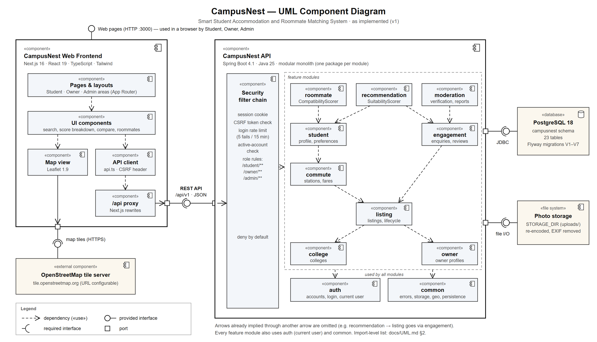

Source: [component-diagram.svg](diagrams/component-diagram.svg). The frontend *requires* the REST API that the
backend *provides* (ball-and-socket assembly through ports); the backend requires PostgreSQL (JDBC) and the photo
folder; the map view requires OpenStreetMap tiles.

Direct dependencies between backend modules, from the Java `import` statements (excluding `common`, and `auth`
used for the current user). The diagram draws only the arrows not already implied by other arrows:

| Module | Depends on |
|---|---|
| recommendation | student, engagement, listing, commute, owner, college |
| moderation | engagement, listing, owner |
| roommate | student |
| student | commute, listing (amenities, room types), college |
| engagement | listing |
| commute | listing, college |
| listing | owner, college (the demo-data seeder also uses student, roommate, commute) |
| auth | student, owner (registration creates the profile) |
| owner, college | — |

### 2.2 Request flow overview

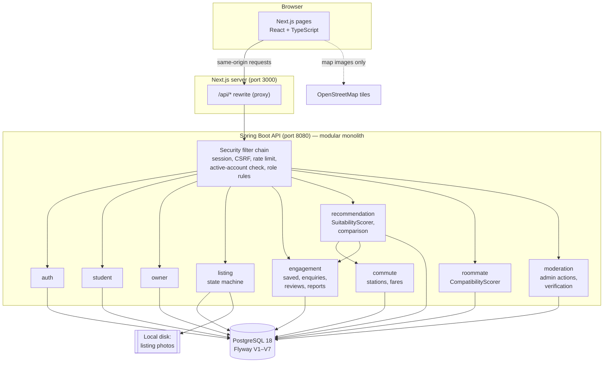

---

## 3. Class diagram (domain model)

Only the main fields and methods are shown. Arrows are JPA associations.

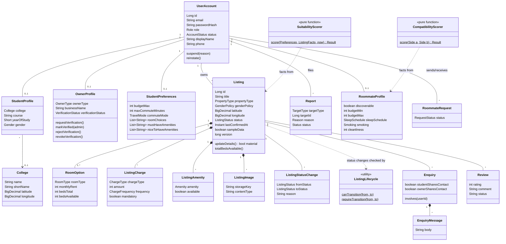

---

## 4. Entity relationship diagram

The full, current schema (Flyway V1–V7). Column details are in [DATABASE.md](DATABASE.md).

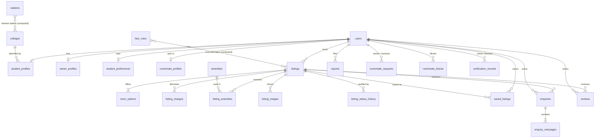

---

## 5. State machine diagrams

### 5.1 Listing lifecycle (implemented in `ListingLifecycle.java`)

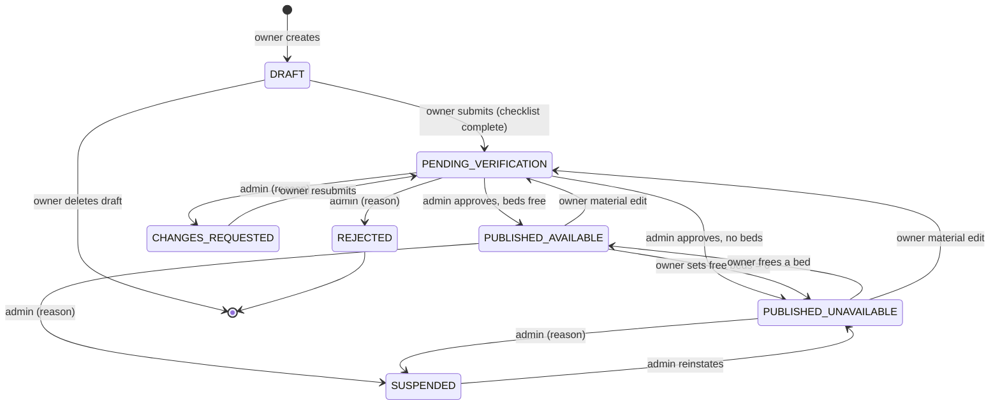

### 5.2 Owner identity verification

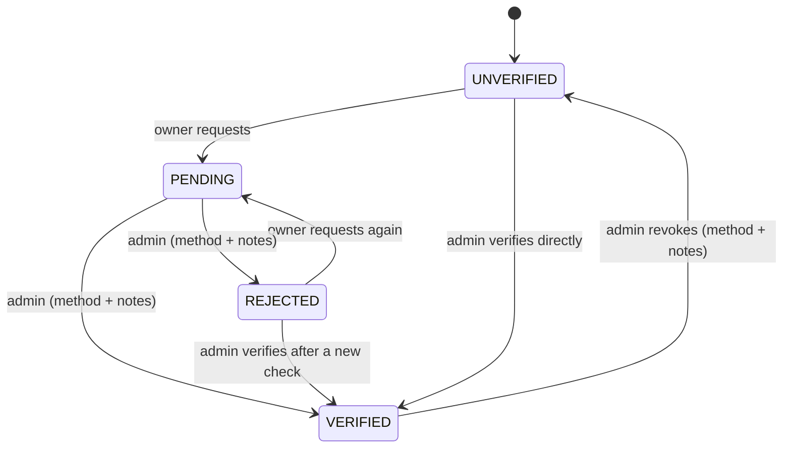

### 5.3 Roommate request

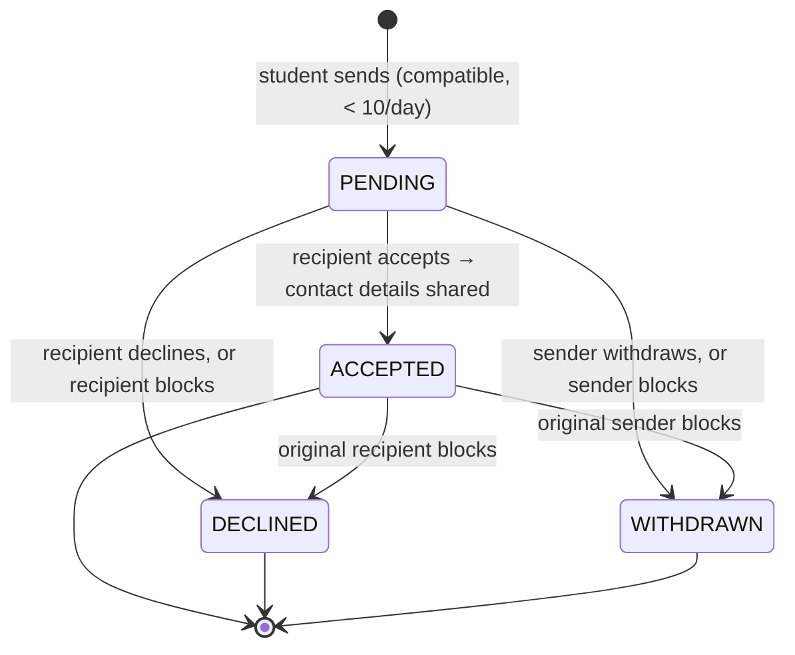

### 5.4 Report

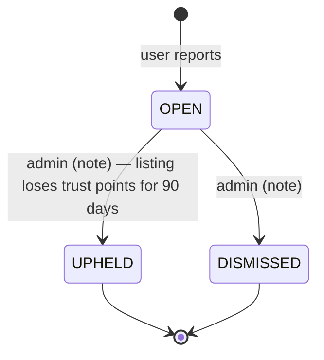

---

## 6. Sequence diagrams

### 6.1 Login (Spring Security form login, session cookie, CSRF)

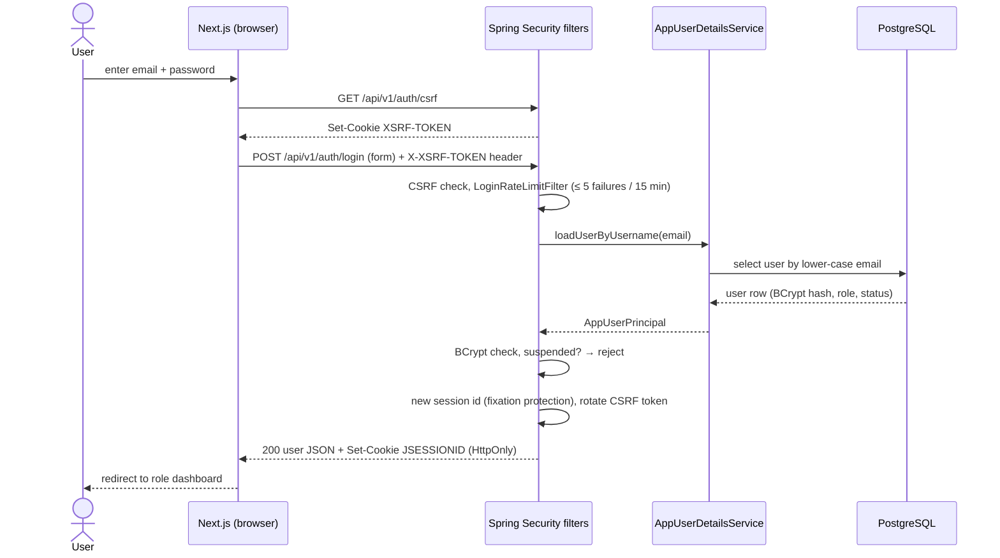

### 6.2 Ranked recommendations (FR-1)

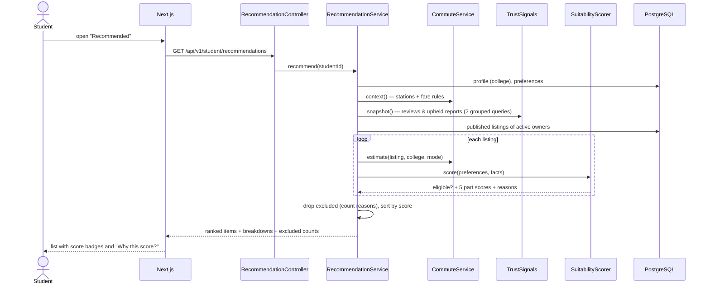

### 6.3 Owner submits, admin reviews (FR-3)

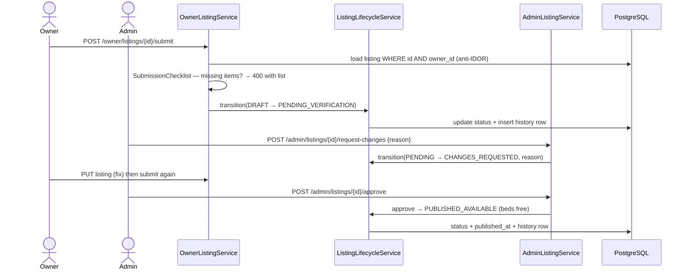

### 6.4 Roommate request with privacy (FR-2)

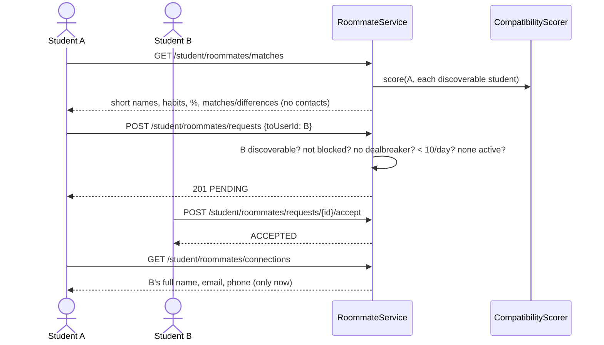

---

## 7. Activity diagrams

### 7.1 Student finds accommodation

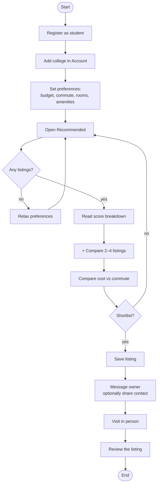

### 7.2 Owner lists a property

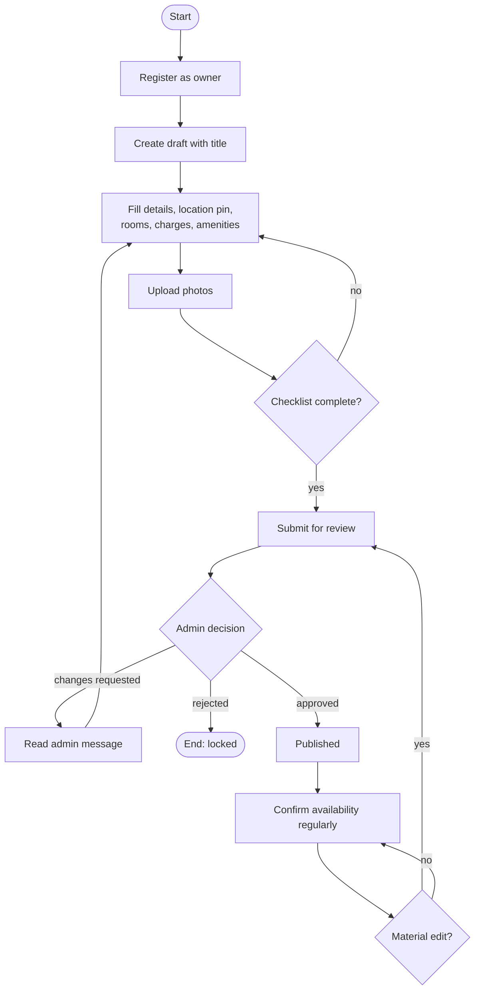

---

## 8. Deployment diagram

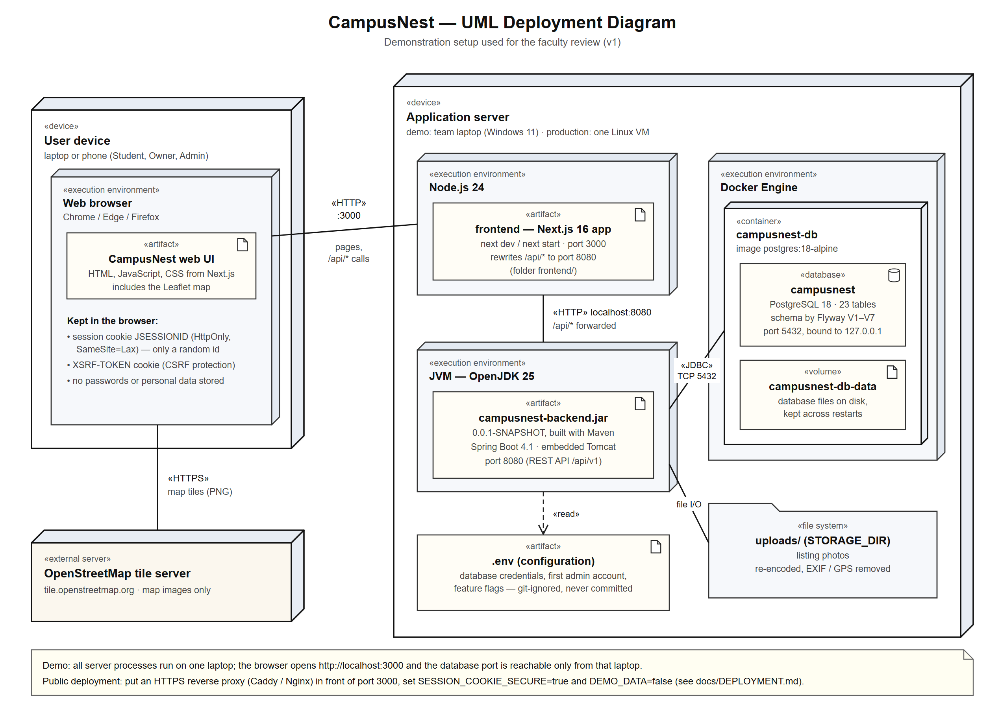

Source: [deployment-diagram.svg](diagrams/deployment-diagram.svg). Shows the demonstration setup: the browser on the
user's device talks HTTP to the Next.js server (port 3000), which forwards `/api/*` to the Spring Boot jar on the
JVM (port 8080); the backend reaches PostgreSQL in a Docker container over JDBC (port 5432, bound to 127.0.0.1)
and stores photos in the `uploads/` folder. Production changes are listed in [DEPLOYMENT.md](DEPLOYMENT.md).
